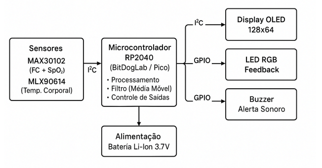
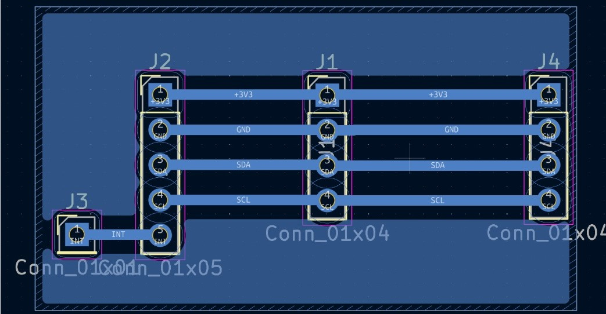
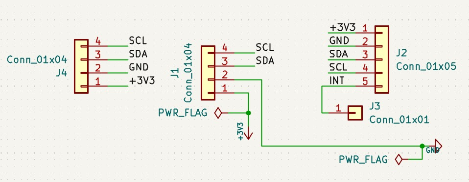
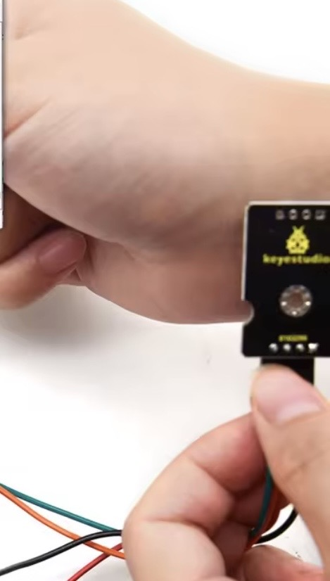
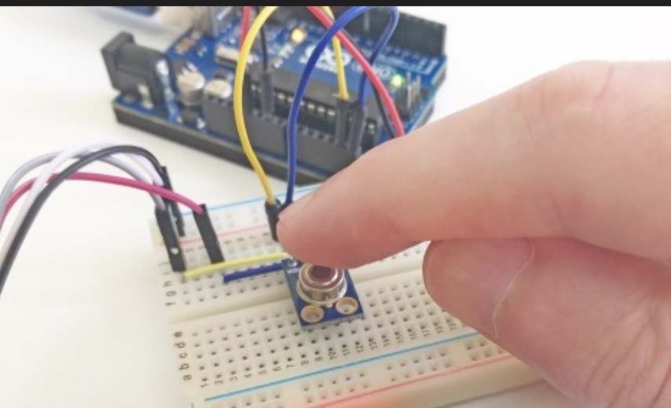

# Monitor de Sinais Vitais - Raspberry Pi Pico

Um sistema completo de monitoramento de sinais vitais implementado para o
microcontrolador Raspberry Pi Pico, utilizando sensores MAX30102 e MLX90614,
com feedback visual através de LED RGB, display OLED SSD1306, buzzer para alertas
e controle via botão para iniciar medições.

## 📋 Descrição do Sistema

O sistema implementa um monitor de sinais vitais que utiliza sensores biomédicos
para realizar medições de frequência cardíaca, saturação de oxigênio (SpO2) e
temperatura corporal. As medições são iniciadas através de um botão e duram 20 segundos,
com os resultados exibidos em tempo real no display OLED SSD1306 e feedback visual
através de LED RGB e alertas sonoros via buzzer.

## ✨ Funcionalidades

-   **Medição de Frequência Cardíaca**: Utiliza sensor MAX30102 para medição de BPM através de detecção de picos no sinal
-   **Medição de SpO2**: Sensor MAX30102 para saturação de oxigênio no sangue calculada pela razão de razões (R)
-   **Medição de Temperatura**: Sensor MLX90614 para temperatura corporal sem contato (infravermelho)
-   **Display OLED**: Exibição em tempo real dos sinais vitais no display SSD1306
-   **Feedback Visual**: LED RGB indica status dos sinais vitais (verde=normal, amarelo=atenção, vermelho=crítico)
-   **Alertas Sonoros**: Buzzer emite alertas quando valores críticos são detectados
-   **Controle por Botão**: Botão para iniciar ciclo de medição de 20 segundos

## 🔧 Componentes de _Hardware_

### _On-board_
-   **Raspberry Pi Pico**
-   **LED RGB** (Vermelho, Verde e Azul)
-   **Display OLED SSD1306** (128x64 pixels, I2C1)
-   **Buzzer** (GPIO 21, conectado via transistor)
-   **Botão** (GPIO 5, pull-up interno)

### _Off-board_
-   **Sensor MAX30102** (Frequência cardíaca e SpO2, I2C0)
-   **Sensor MLX90614** (Temperatura sem contato, I2C0)

### 🔧 Detalhes Técnicos

-   **Linguagem**: C (SDK Raspberry Pi Pico)
-   **Display**: OLED SSD1306 128x64 (I2C1, endereço 0x3C)
-   **I2C0**: Ambos os sensores (MAX30102 e MLX90614) compartilham o mesmo barramento
  - GPIO 8 (SDA) e GPIO 9 (SCL)
  - Baudrate: 100kHz (requerido pelo MLX90614)
-   **I2C1**: Display OLED SSD1306
  - GPIO 2 (SDA) e GPIO 3 (SCL)
  - Baudrate: 400kHz
-   **LED RGB**: 3 GPIOs individuais (Vermelho: GPIO 13, Verde: GPIO 11, Azul: GPIO 12)
-   **Botão**: GPIO 5 (pull-up interno, pressionado = LOW)
-   **Buzzer**: GPIO 21 (conectado via transistor)
-   **Duração da Medição**: 20 segundos quando botão é pressionado
-   **Intervalo de Amostragem**: 200ms entre leituras durante medição
-   **Atualização de Display**: 500ms

### 📊 Especificações dos Sensores (Componentes Centrais)

O sistema utiliza os seguintes sensores biomédicos:

**MAX30102 (Frequência Cardíaca e SpO2):**
- **Endereço I2C**: 0x57 (padrão)
- **Taxa de amostragem**: 100 Hz
- **Alcance de frequência cardíaca**: 0-300 BPM
- **Alcance de SpO2**: 0-100%
- **LEDs**: Vermelho (660nm) e Infravermelho (880nm)
- **FIFO**: 32 amostras

**MLX90614 (Temperatura):**
- **Endereço I2C**: 0x5A (padrão)
- **Alcance de temperatura**: -70°C a 380°C (objeto), -40°C a 125°C (ambiente)
- **Tipo**: Sensor infravermelho sem contato
- **Tempo de resposta**: <100ms

### 🔬 Algoritmos Aplicados

O sistema utiliza os seguintes algoritmos para processamento de sinais e conversão de valores digitais:

#### **Cálculo de Frequência Cardíaca (BPM)**
- **Algoritmo**: Detecção de picos com janela deslizante
- **Método**: 
  1. Coleta de amostras do LED vermelho do MAX30102 via FIFO (taxa de 100 Hz)
  2. Cálculo de threshold dinâmico: `threshold = (max_val + min_val) / 2`
  3. Detecção de picos locais usando janela de 5 amostras (verificação de máximo local)
  4. Cálculo de intervalos entre picos consecutivos
  5. Filtragem de intervalos irrealistas (mantém apenas intervalos entre 300-2000 ms, correspondendo a 30-200 BPM)
  6. Cálculo de BPM: `BPM = 60000 / intervalo_médio`
- **Filtragem**: Intervalos são filtrados para remover artefatos e ruído

#### **Cálculo de SpO2 (Saturação de Oxigênio)**
- **Algoritmo**: Razão de Razões (Ratio of Ratios - R)
- **Método**:
  1. Separação de componentes DC (média) e AC (pico-a-pico) para sinais vermelho e infravermelho
  2. Cálculo de componente DC: `DC = média de todas as amostras`
  3. Cálculo de componente AC: `AC = max - min` (amplitude pico-a-pico)
  4. Cálculo da razão de razões: `R = (AC_vermelho/DC_vermelho) / (AC_IR/DC_IR)`
  5. Limitação de R ao intervalo [0.2, 2.0] para valores fisiológicos válidos
  6. Conversão para SpO2: `SpO2 = 125 - 15 * R`
  7. Limitação final: SpO2 entre 70% e 100%
- **Base teórica**: O algoritmo utiliza a diferença de absorção de luz entre hemoglobina oxigenada e desoxigenada nas frequências vermelha (660nm) e infravermelha (880nm)

#### **Conversão de Temperatura (MLX90614)**
- **Algoritmo**: Conversão linear com offset de calibração
- **Método**:
  1. Leitura do valor bruto de 16 bits do registro de temperatura do objeto (0x07)
  2. Conversão para Kelvin: `temp_K = raw_value * 0.02` (resolução de 0.02K por LSB)
  3. Conversão para Celsius: `temp_C = temp_K - 273.15`
- **Precisão**: Resolução de 0.02K permite medições com precisão de ±0.1°C

#### **Filtragem de Sinais**
- **Algoritmo**: Média móvel simples
- **Aplicação**: Suavização de valores de temperatura e SpO2 para reduzir ruído
- **Implementação**: Buffer circular com 10 amostras, cálculo de média aritmética

### 🏗️ Arquitetura do Sistema

### Diagrama de Blocos



**Componentes Principais:**

- **Microcontrolador**: Raspberry Pi Pico (RP2040)
- **Sensor de Frequência Cardíaca/SpO2**: MAX30102 via I2C0 (endereço 0x57)
- **Sensor de Temperatura**: MLX90614 via I2C0 (endereço 0x5A)
- **Display**: OLED SSD1306 via I2C1 (endereço 0x3C)
- **Feedback Visual**: LED RGB via GPIO (11, 12, 13)
- **Alertas Sonoros**: Buzzer via GPIO 21
- **Controle**: Botão via GPIO 5

**Conexões entre RP2040 e Periféricos**
- **GPIO 8 (SDA) e GPIO 9 (SCL)**: I2C0 - Sensores MAX30102 e MLX90614 (compartilham o mesmo barramento)
- **GPIO 2 (SDA) e GPIO 3 (SCL)**: I2C1 - Display OLED SSD1306
- **GPIO 5**: Botão (pull-up interno)
- **GPIO 11**: LED Verde
- **GPIO 12**: LED Azul
- **GPIO 13**: LED Vermelho
- **GPIO 21**: Buzzer (via transistor)

## 🗺️ Fluxo de Controle Principal (Pseudo-código)

```pseudocode
🔧 INICIAR:
    Inicializar stdio USB
    Executar recuperação de barramento I2C0 (GPIO 8/9)
    Inicializar I2C0 para ambos os sensores (GPIO 8/9, 100kHz)
    Inicializar I2C1 para display (GPIO 2/3, 400kHz)
    Escanear barramentos I2C para detecção de sensores
    Inicializar MAX30102 (configurar FIFO, modo SpO2, LEDs)
    Inicializar MLX90614 (verificar comunicação)
    Inicializar display OLED SSD1306
    Inicializar LED RGB (GPIO 11, 12, 13)
    Inicializar buzzer (GPIO 21)
    Inicializar botão (GPIO 5, pull-up)
    Mostrar tela inicial no display: "MONITOR DE SAUDE VITAL"
    LED RGB azul (inicialização)

🔄 ENQUANTO sistema_ativo:
    1️⃣ Verificar estado do botão:
        a) SE botão pressionado (borda de descida):
           - Beep curto (50ms)
           - Mostrar contagem regressiva no display (2 segundos)
           - Resetar estado de alertas do buzzer
           - Iniciar ciclo de medição de 20 segundos
    
    2️⃣ DURANTE ciclo de medição (20 segundos):
        a) 🔬 COLETA DE DADOS:
           - Ler FIFO do MAX30102 continuamente (a cada 50ms)
             * Armazenar amostras vermelhas e infravermelhas
             * Armazenar timestamps para cálculo de BPM
           - Ler SpO2 do MAX30102 periodicamente (a cada 200ms)
           - Ler temperatura do MLX90614 periodicamente (a cada 200ms)
           - Mostrar "MEDINDO SINAIS VITAIS..." no display
        
        b) 🔬 APÓS 20 SEGUNDOS:
           - Calcular frequência cardíaca (ver algoritmo de detecção de picos):
             * Detectar picos no sinal vermelho usando threshold dinâmico
             * Calcular intervalos entre batimentos
             * Filtrar intervalos irrealistas (30-200 BPM)
             * Calcular BPM médio: BPM = 60000 / intervalo_médio
           - Calcular SpO2 (ver algoritmo de razão de razões):
             * Calcular componente DC (média) e AC (pico-a-pico) para vermelho e IR
             * Calcular razão de razões: R = (AC_vermelho/DC_vermelho) / (AC_IR/DC_IR)
             * Converter para SpO2: SpO2 = 125 - 15*R
             * Limitar entre 70% e 100%
           - Calcular temperatura (ver algoritmo de conversão):
             * Média de todas as leituras coletadas
             * Aplicar conversão: temp_C = (raw * 0.02) - 273.15
           - Beep curto (50ms) indicando fim da medição
    
    3️⃣ 🔬 ATUALIZAÇÃO DO DISPLAY (a cada 500ms):
        a) Limpar buffer do display
        b) Exibir título "SINAIS VITAIS"
        c) Exibir frequência cardíaca: "FC: XXX BPM" ou "FC: --- BPM"
        d) Exibir SpO2: "SPO2: XXX.X%" ou "SPO2: ---%"
        e) Exibir temperatura: "TEMP: XXX.X C" ou "TEMP: --- C"
        f) Renderizar no display OLED
    
    4️⃣ 🔬 FEEDBACK VISUAL - LED RGB (a cada 200ms):
        a) Verificar valores dos sinais vitais
        b) SE condição CRÍTICA (qualquer valor fora dos limites normais):
           - LED Vermelho (255, 0, 0)
        c) SENÃO SE condição de AVISO (valores próximos dos limites):
           - LED Amarelo (255, 255, 0)
        d) SENÃO SE todos os valores normais:
           - LED Verde (0, 255, 0)
        e) SENÃO (sem medições válidas):
           - LED Azul (0, 0, 255)
    
    5️⃣ 🔬 ALERTAS SONOROS - BUZZER (a cada 200ms):
        a) Verificar condições críticas:
           - SpO2 < 90%: CRÍTICO
           - Temperatura < 35.0°C ou > 37.5°C: CRÍTICO
           - Frequência cardíaca < 60 ou > 130 BPM: CRÍTICO
        b) SE condição crítica detectada:
           - Emitir 3 beeps rápidos (100ms cada, 300ms entre beeps)
           - Após 3 beeps, desligar buzzer
        c) SENÃO:
           - Buzzer desligado

🏁 FIM:
    Sistema continua rodando indefinidamente
```

## Implementação Física de _Hardware_ _Off-line_



### Esquemático do circuito



## Interface com Mundo Físico

### Entradas

- **Sensor MAX30102 (I2C0 - GPIO 8/9, endereço 0x57)**: Sensor de frequência cardíaca e SpO2
  - Requer contato físico com o dedo
  - LEDs vermelho (660nm) e infravermelho (880nm) emitem luz através do tecido
  - Fotodiodo detecta luz refletida/transmitida
  - Dados lidos via FIFO do sensor (32 amostras)
  - Taxa de amostragem: 100 Hz
  - Compartilha barramento I2C0 com MLX90614
  - **Posicionamento**: Ver figura de posicionamento do MAX30102 abaixo para garantir exatidão das medições



- **Sensor MLX90614 (I2C0 - GPIO 8/9, endereço 0x5A)**: Sensor de temperatura sem contato
  - Mede temperatura por infravermelho
  - Não requer contato físico
  - Apontar para testa ou região temporal
  - Distância recomendada: 1-5 cm
  - Leitura do registro de temperatura do objeto (0x07)
  - Compartilha barramento I2C0 com MAX30102
  - Requer baudrate de 100kHz
  - **Posicionamento**: Ver figura de posicionamento do MLX90614 abaixo para garantir exatidão das medições e reprodutibilidade do sistema



- **Botão (GPIO 5)**: Controle do sistema
  - Pull-up interno (pressionado = LOW)
  - Pressionar para iniciar ciclo de medição de 20 segundos
  - Debounce de 50ms implementado

### Saídas

- **Display OLED SSD1306 (I2C1 - GPIO 2/3, endereço 0x3C)**: Interface visual principal
  - Resolução: 128x64 pixels
  - Exibe título "SINAIS VITAIS"
  - Mostra frequência cardíaca: "FC: XXX BPM" ou "FC: --- BPM"
  - Mostra SpO2: "SPO2: XXX.X%" ou "SPO2: ---%"
  - Mostra temperatura: "TEMP: XXX.X C" ou "TEMP: --- C"
  - Atualização automática a cada 500ms
  - Mostra mensagens de preparação e contagem regressiva

- **LED RGB (GPIO 11, 12, 13)**: Feedback visual do status
  - **Verde (GPIO 11)**: Todos os sinais vitais normais
  - **Amarelo (GPIO 11+13)**: Algum valor em atenção (fora da faixa ideal)
  - **Vermelho (GPIO 13)**: Algum valor crítico (requer atenção imediata)
  - **Azul (GPIO 12)**: Sistema em inicialização ou aguardando medições

- **Buzzer (GPIO 21)**: Alertas sonoros
  - Conectado via transistor
  - Frequência: 2.7 kHz
  - Emite 3 beeps rápidos (100ms cada, 300ms entre beeps) quando valores críticos são detectados
  - Beep curto (50ms) ao pressionar botão e ao finalizar medição

### Guia de Uso

#### 🚀 Inicialização do Sistema

1. **Ligue o sistema**: Conecte a alimentação USB à Raspberry Pi Pico
2. **Aguarde inicialização**: O sistema executará detecção automática dos sensores
3. **Verifique conexões**: O display mostrará "MONITOR DE SAUDE VITAL" e "Pressione botao para iniciar"
4. **Sistema pronto**: O LED RGB ficará azul durante inicialização, indicando que o sistema está pronto

#### 💓 Realizando Medições

1. **Posicione o sensor MAX30102**: Coloque o dedo sobre o sensor (LEDs devem estar em contato com a pele). Consulte a figura de posicionamento do MAX30102 para garantir o posicionamento ideal.
2. **Posicione o sensor MLX90614**: Aponte o sensor para a pele (distância de 1-5 cm). Consulte a figura de posicionamento do MLX90614 para garantir medições precisas e reprodutíveis.
3. **Pressione o botão**: O sistema iniciará um ciclo de medição de 20 segundos
4. **Aguarde contagem regressiva**: O display mostrará "PREPARE-SE" e contagem de 2 segundos
5. **Mantenha posição durante medição**: O display mostrará "MEDINDO SINAIS VITAIS..." por 20 segundos
6. **Observe os resultados**: Após 20 segundos, os valores serão exibidos no display OLED
7. **Observe o LED RGB**: A cor indica o status geral dos sinais vitais
8. **Alertas sonoros**: O buzzer emitirá alertas se valores críticos forem detectados

#### ⚠️ Dicas Importantes

- **Posicionamento do MAX30102**: O dedo deve cobrir completamente os LEDs e o fotodiodo. Consulte a figura de posicionamento para visualizar a forma ideal de colocação.
- **Posicionamento do MLX90614**: Aponte o sensor diretamente para a testa ou região temporal, mantendo distância de 1-5 cm. Consulte a figura de posicionamento para garantir exatidão das medições.
- **Estabilidade**: Mantenha o dedo e o sensor MLX90614 imóveis durante a medição para melhor precisão
- **Iluminação ambiente**: Evite luz solar direta no sensor MAX30102
- **Temperatura ambiente**: O MLX90614 mede temperatura relativa, considere a temperatura ambiente
- **Filtragem**: Os valores são filtrados para reduzir ruído, pode haver pequeno atraso
- **Calibração**: Os valores de SpO2 são aproximados, para uso médico requer calibração profissional

#### 📊 Interpretação dos Valores e Condições de Monitoramento

**Frequência Cardíaca (BPM):**
- **Normal**: 60-130 BPM
- **Crítico**: < 60 ou > 130 BPM (LED vermelho, buzzer ativa)

**SpO2 (%):**
- **Normal**: ≥ 95%
- **Atenção**: 90-95% (LED amarelo)
- **Crítico**: < 90% (LED vermelho, buzzer ativa)

**Temperatura (°C):**
- **Normal**: 35.0-37.5°C
- **Crítico**: < 35.0°C ou > 37.5°C (LED vermelho, buzzer ativa)

**Lógica de Monitoramento:**
- O sistema verifica continuamente os valores após a medição
- LED Verde: Todos os valores dentro da faixa normal
- LED Amarelo: Valores próximos dos limites (SpO2 entre 90-95%, ou temperatura/FC na borda da normalidade)
- LED Vermelho: Qualquer valor crítico detectado
- Buzzer: Emite 3 beeps rápidos quando qualquer condição crítica é detectada

## 🚀 Instalação e Configuração

### Pré-requisitos

- **Visual Studio Code** com as seguintes extensões:
  - **CMake Tools** (Microsoft)
  - **Raspberry Pi Pico** (Wokwi)
  - **Cortex-Debug** (marus25)
- **DAP Link** para carregamento (_flashing_) e depuração (_debugging_) (opcional)
- **Raspberry Pi Pico SDK** instalado


### 1. Clonar o Repositório

```bash
git clone <URL_DO_REPOSITORIO>
cd P3
```

### 2. Configurar e Executar no VSCode

1. **Abrir o projeto no VSCode**:
   ```bash
   code .
   ```

2. **Importar o projeto na extensão Raspberry Pi Pico**:
   - Vá para a extensão "Raspberry Pi Pico" no VSCode
   - Clique em "Import Project" ou "Importar Projeto"
   - Selecione a pasta do projeto clonado

3. **Conectar o _hardware_**:
   - Consulte o esquemático (`hardware.kicad_sch`) para detalhes completos das conexões
   - **Resumo das conexões principais**:
     - I2C0 (GPIO 8/9): Sensores MAX30102 e MLX90614
     - I2C1 (GPIO 2/3): Display OLED SSD1306
     - GPIO 5: Botão (pull-up interno)
     - GPIO 11, 12, 13: LED RGB (Verde, Azul, Vermelho)
     - GPIO 21: Buzzer (via transistor)
   - Conecte o DAP Link aos pinos DEBUG da Raspberry Pi Pico (opcional para debug)
   - Certifique-se de que a Pico está conectada via USB

4. **Compilar e Debuggar**:
   - Na extensão Raspberry Pi Pico, clique em "Debug" ou "Debugar"
   - A extensão automaticamente:
     - Compila o projeto
     - Faz o flashing para a Pico
     - Inicia a sessão de debugging
   - Use breakpoints e inspeção de variáveis conforme necessário

5. **Monitorar o sistema**:
   - A interface principal é o display OLED SSD1306
   - Para depuração, use breakpoints e inspeção de variáveis no VS Code com CMSIS-DAP
   - Opcionalmente, você pode abrir um terminal serial (115200 baud) para ver logs de inicialização

## 🧪 Testes de Validação

Foram conduzidos os seguintes procedimentos de teste para validar o funcionamento do sistema:

### **Teste do Sensor MAX30102**
- Verificação da detecção do sensor no barramento I2C1
- Teste de leitura do registro PART_ID (0xFF)
- Validação da leitura de dados FIFO (vermelho e infravermelho)
- Teste de cálculo de frequência cardíaca com dedo posicionado
- Teste de cálculo de SpO2 com diferentes condições
- Validação da detecção automática de endereço alternativo (0x40)

### **Teste do Sensor MLX90614**
- Verificação da detecção do sensor no barramento I2C0
- Teste de leitura do registro de configuração (0x25)
- Validação da leitura de temperatura do objeto (0x07)
- Teste de conversão de valores brutos para Celsius
- Validação da precisão com termômetro de referência
- Teste de detecção automática de endereço alternativo

### **Teste do Filtro de Sinais**
- Verificação da inicialização do filtro de média móvel
- Teste de adição de amostras ao filtro
- Validação da suavização de valores ruidosos
- Teste de comportamento com buffer completo (10 amostras)
- Validação da resposta a mudanças rápidas de valores

### **Teste do LED RGB**
- Verificação da inicialização e controle individual de cada cor
- Teste de transição de cores baseada nos sinais vitais
- Validação do LED verde para valores normais
- Validação do LED amarelo para valores em atenção
- Validação do LED vermelho para valores críticos
- Teste do LED azul durante inicialização

### **Teste do Display OLED**
- Verificação da inicialização do display SSD1306 via I2C1
- Teste de exibição formatada dos valores
- Validação da atualização automática (500ms)
- Teste de mensagens de preparação e contagem regressiva
- Validação da renderização de caracteres e números

### **Teste do Botão**
- Verificação da inicialização do GPIO 5 com pull-up
- Teste de detecção de borda de descida (pressionamento)
- Validação do debounce (50ms)
- Teste de trigger do ciclo de medição

### **Teste do Buzzer**
- Verificação da inicialização do GPIO 21
- Teste de beep curto (50ms) ao pressionar botão
- Validação de alertas sonoros para condições críticas (3 beeps)
- Teste de frequência (2.7 kHz)

### **Teste de Integração**
- Validação do funcionamento simultâneo de todos os sensores no mesmo barramento I2C0
- Teste de leitura concorrente no barramento I2C0 (sensores) e I2C1 (display)
- Validação da sincronização entre leitura, cálculo e exibição
- Teste de ciclo completo de medição (botão → contagem → medição → resultados)
- Teste de comportamento com sensores desconectados
- Validação da recuperação automática do barramento I2C
- Teste de feedback visual e sonoro baseado nos valores medidos

Todos os testes foram concluídos com resultado satisfatório

## ⚠️ Limitações

-   Os valores de SpO2 são aproximados e requerem calibração para uso médico profissional
-   A precisão da frequência cardíaca depende do posicionamento correto do dedo no sensor
-   A temperatura medida pelo MLX90614 é relativa e pode variar com a temperatura ambiente
-   O sistema não possui armazenamento de histórico de medições
-   Não há tratamento de erros para falhas de comunicação I2C persistentes
-   Os valores de referência (normal/atenção/crítico) são genéricos e podem variar por indivíduo
-   O sistema não substitui equipamentos médicos profissionais para diagnóstico

## 📚 Referências e Bibliotecas Utilizadas

Este projeto utiliza referências e implementações de bibliotecas de código aberto:

- **MAX30102 Driver Library**: Implementação de referência para comunicação com o sensor MAX30102
  - Repositório: [libdriver/max30102](https://github.com/libdriver/max30102)
  - Arquivo de referência: [driver_max30102.c](https://github.com/libdriver/max30102/blob/main/src/driver_max30102.c)

- **MLX90614 Library Reference**: Documentação e referência para comunicação com o sensor MLX90614
  - Repositório: [mcauser/micropython-mlx90614](https://github.com/mcauser/micropython-mlx90614)
  - Documentação: [README.md](https://github.com/mcauser/micropython-mlx90614/blob/master/README.md)

## 🤝 Autores

Este projeto foi desenvolvido por **Beatriz Moreira** e **Gustavo de Melo**   
como parte da disciplina **EA801** (turma A) na **FEEC** da **Unicamp**.

## 📄 Licença

Este projeto é parte de um trabalho acadêmico da disciplina EA801 - 
Sistemas Embarcados da Unicamp.

---

**Monitor de Sinais Vitais na sua Raspberry Pi Pico!** 💓🌡️✨
